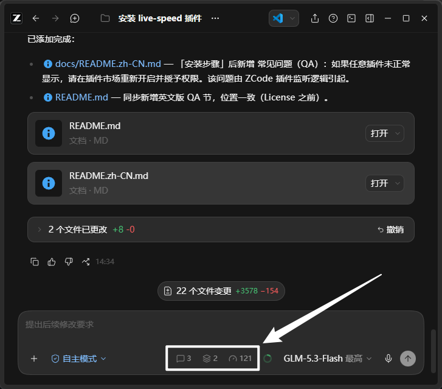

# Live Speed Plugin

Three status chips in the ZCode composer: conversation turns, model steps, and tokens per second.

[简体中文](docs/README.zh-CN.md)

## Installation effect

## Installation

1. Open **Plugin Marketplace → Add → Add Plugin Marketplace** in ZCode, paste the absolute path to this repository root (e.g. `C:\path\to\live-speed`), then click Add.
2. Go to **Personal → live-speed** and install the three plugins: Conversation turns (`composer-stats-turn`), Steps per turn (`composer-stats-step`), and Generation speed (`composer-stats-speed`).
3. Approve the `sessions.read` grant for turn and step when prompted.
4. Manage them any time under **Settings → Plugins**.
5. Send a message in a new session. The three chips appear at the bottom of the composer.

## QA

If any plugin does not display properly, re-enable it in the plugin marketplace and grant the permissions again. This issue is caused by ZCode's plugin listening logic.

## License

MIT
