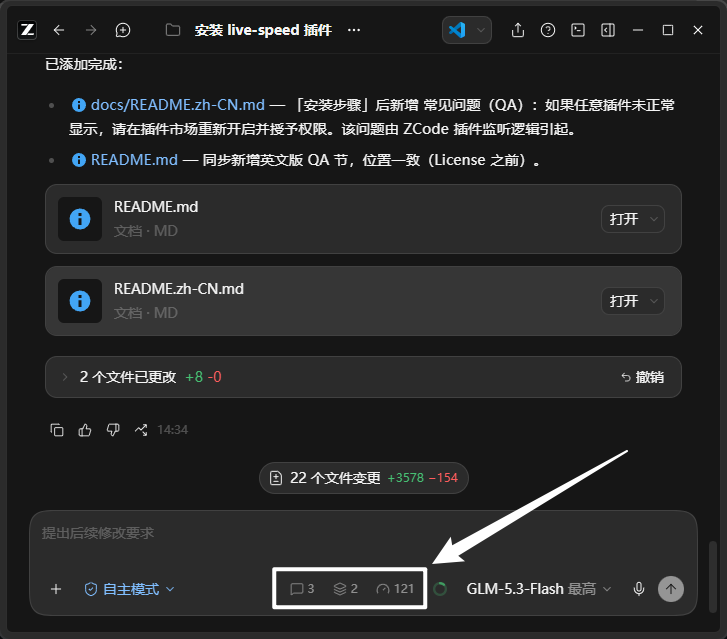

# 时速插件

在 ZCode 输入框状态区显示轮次、步数和 Tokens/秒三个芯片。

[English](README.md)

## 安装效果

## 安装步骤

1. 打开 **插件市场 → 添加 → 添加插件市场**，粘贴本仓库根目录的绝对路径（如 `C:\path\to\live-speed`），点击添加。
2. 进入 **个人 → live-speed**，依次安装三个插件：对话轮次（`composer-stats-turn`）、轮内步数（`composer-stats-step`）、生成速度（`composer-stats-speed`）。
3. turn 与 step 插件会请求 `sessions.read` 授权，按提示同意。
4. 管理入口在 **设置 → 插件**，可随时启用/禁用。
5. 在新会话里发一条消息，输入框右下角会出现三个芯片。

## 常见问题（QA）

如果任意插件未正常显示，请在插件市场重新开启并授予权限。该问题由 ZCode 插件监听逻辑引起。

## 许可证

MIT
